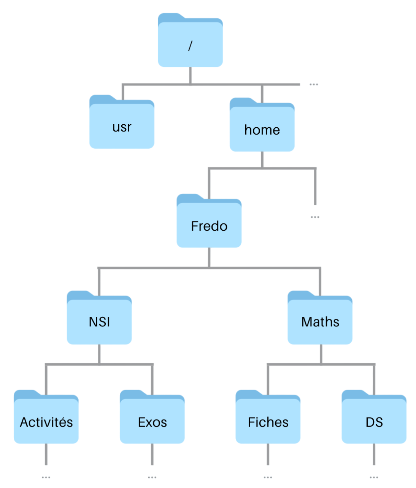
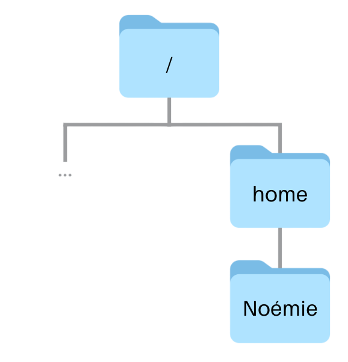
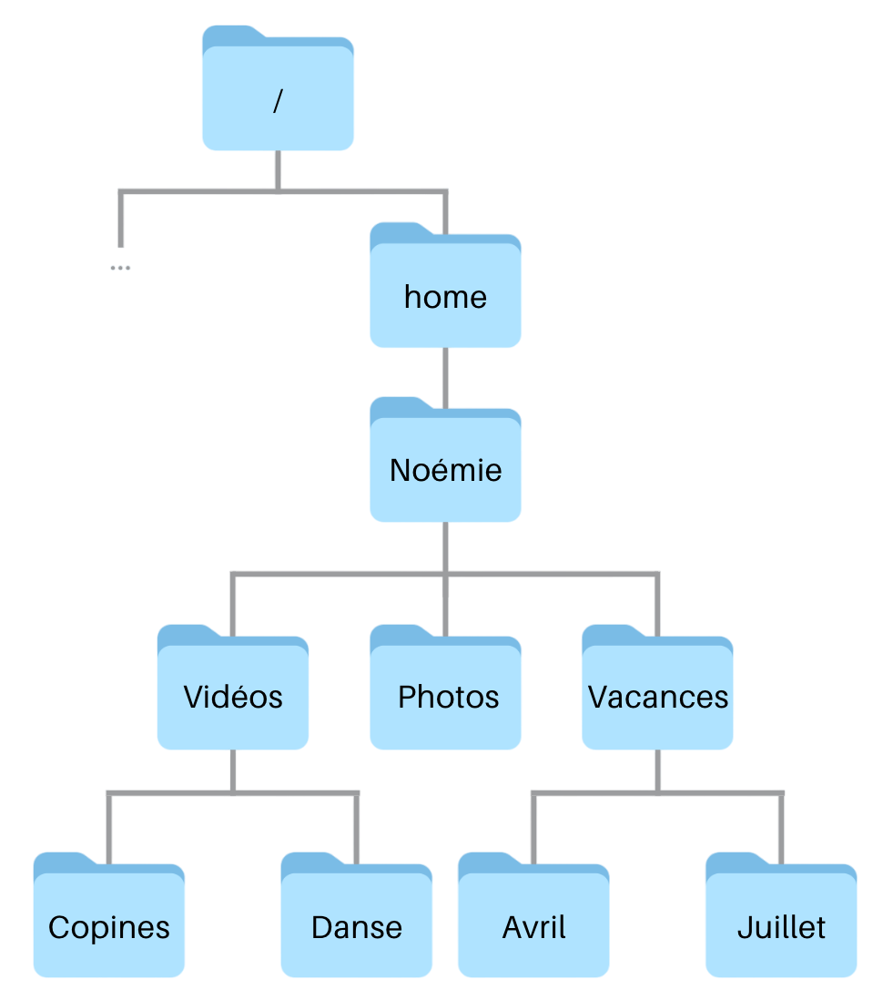
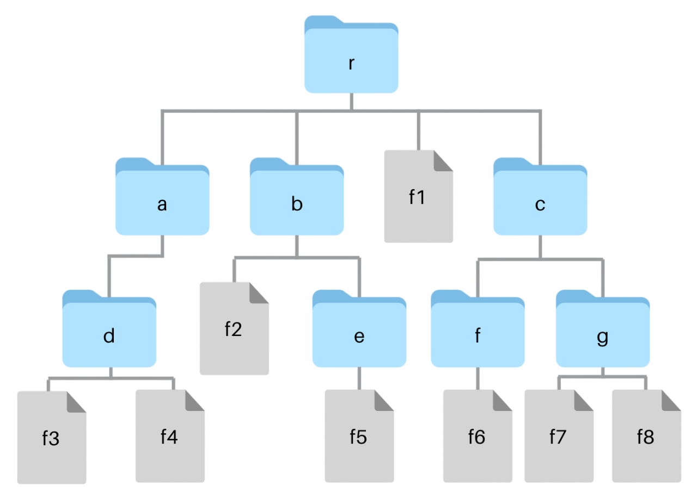
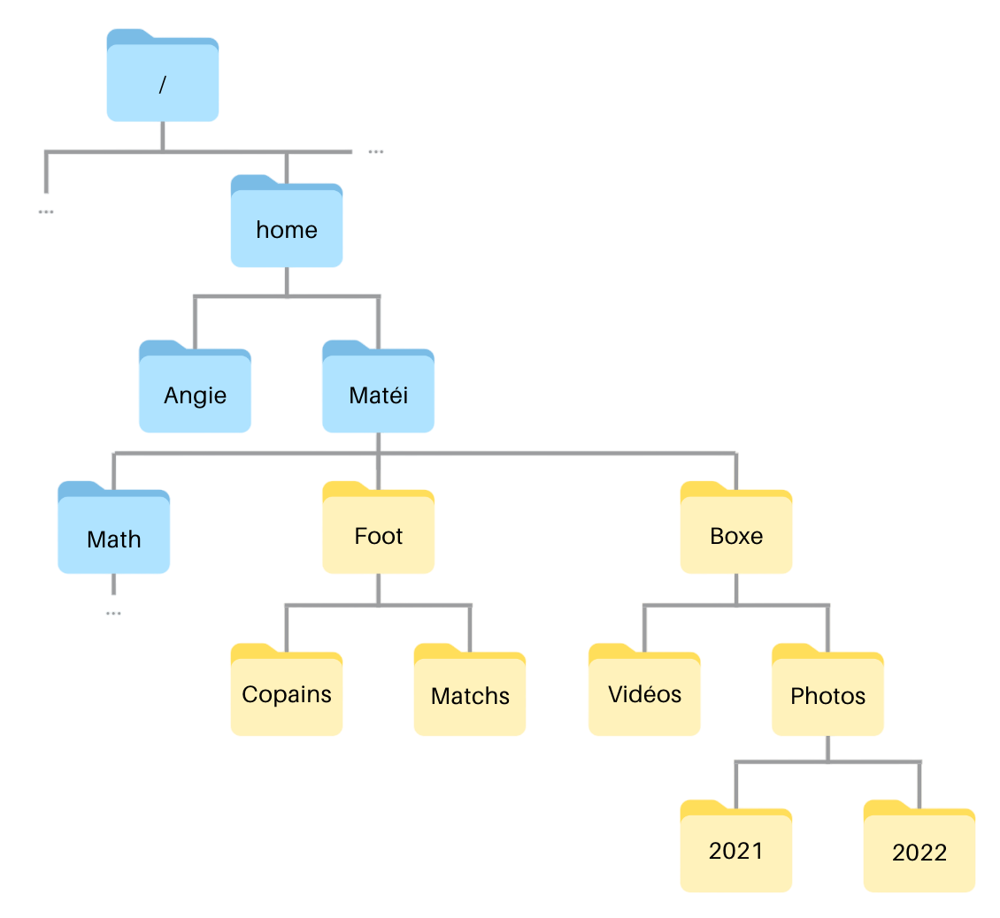
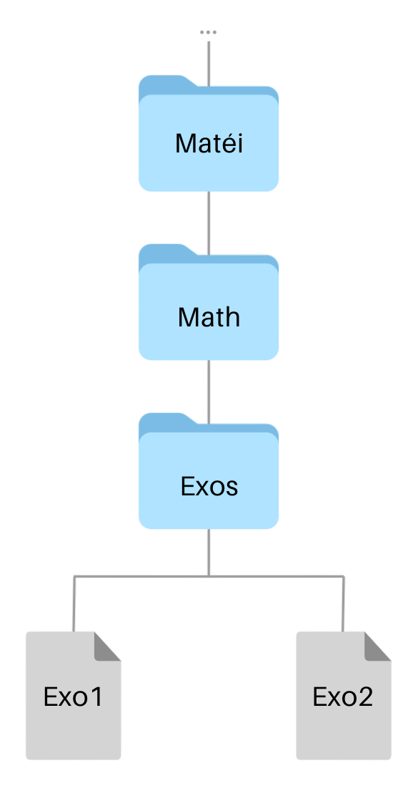
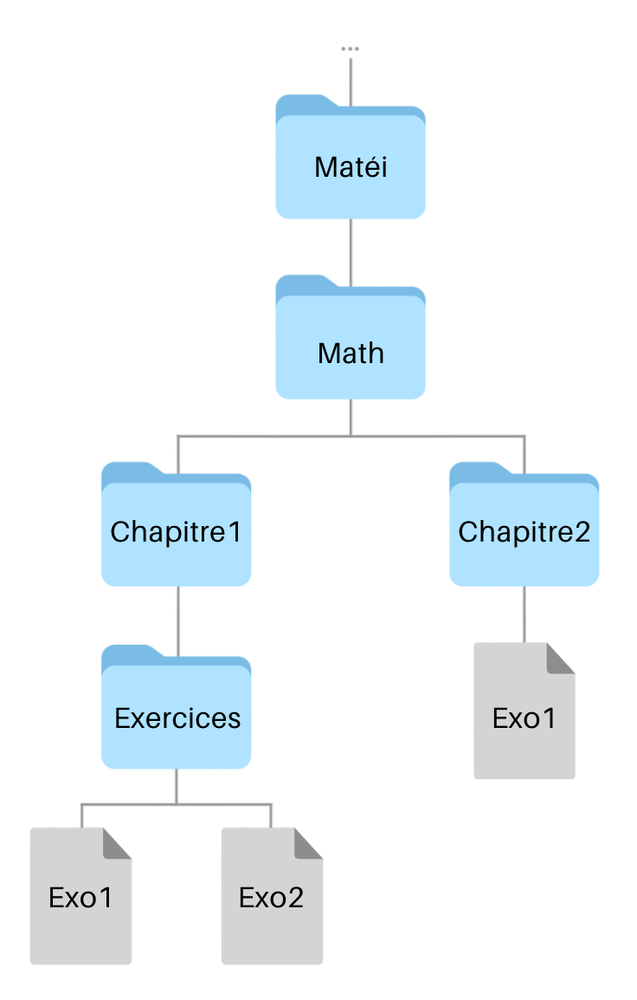
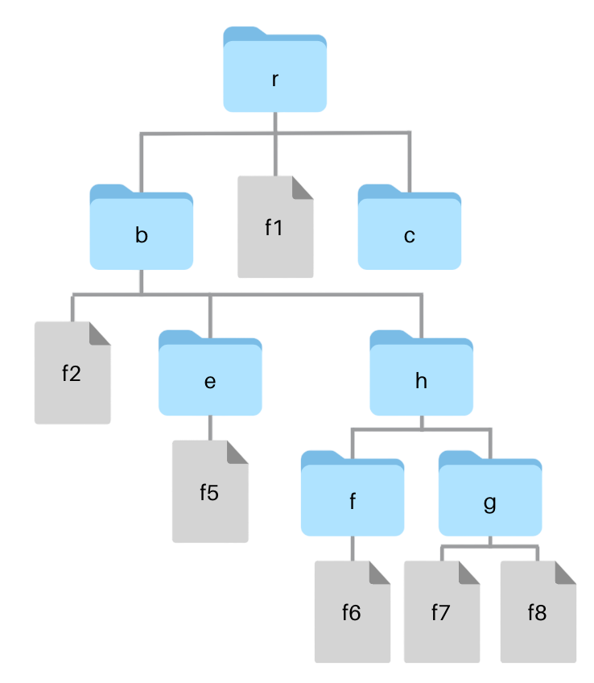

# Exercices 

Vous trouverez ci-dessous les exercices de cette séquence.

- Les exercices marqués avec :fontawesome-solid-pencil: se réalisent **sans ordinateur**.  
  Ceux indiqués par :fontawesome-solid-laptop: nécessitent **un ordinateur**.

- Le **niveau de difficulté** est indiqué par des étoiles :  
    <ul style="list-style: none;">
        <li>:fontawesome-solid-star: :fontawesome-regular-star: :fontawesome-regular-star: → Exercices pour **s'approprier les notions**.</li>
        <li>:fontawesome-solid-star: :fontawesome-solid-star: :fontawesome-regular-star: → Exercices pour **renforcer vos compétences**.</li>
        <li>:fontawesome-solid-star: :fontawesome-solid-star: :fontawesome-solid-star: → Exercices pour vous **challenger** et tester vos acquis.</li>
    </ul>

Les corrections sont généralement disponibles, mais elles ne doivent être consultées **qu'après validation de votre production par l'enseignant**.

---

## Système d'exploitation 

!!! exoordi "Exercice 1 - :fontawesome-solid-star: :fontawesome-regular-star: :fontawesome-regular-star:"
    La page Wikipédia "[Liste des distributions GNU/Linux :octicons-link-external-16:](https://fr.wikipedia.org/wiki/Liste_des_distributions_GNU/Linux)" présente, en fin de page, plusieurs classements de popularité des variantes de Linux (appelées **distributions**).

    1. D'après l'un de ces classements, citer quatre distributions parmi les plus populaires, en précisant la source et la date du classement choisi.
    2. Pourquoi existe-t-il autant de distributions différentes ?

    ??? success "Correction"
        1. Les classements changent selon la source et l'année, plusieurs réponses sont donc possibles. Par exemple :

            - Alexa (octobre 2020) : Ubuntu, Red Hat, Debian, puis CentOS ;
            - SimilarWeb (juin 2020) : Ubuntu, Red Hat, Linux Mint, puis Arch Linux ;
            - SimilarWeb (2022 et 2023) : Raspberry Pi OS, Red Hat Enterprise Linux et Ubuntu en tête.

            Ubuntu, Red Hat et Debian reviennent dans presque tous les classements.

        2. Linux est un **logiciel libre** : chacun a le droit d'étudier son code source, de le modifier et de redistribuer sa version. Des entreprises, des associations ou des passionnés ont donc construit leur propre système autour du noyau Linux.

            Les distributions se distinguent par les logiciels qu'elles fournissent, leur interface graphique, leur façon d'installer les mises à jour et surtout le public visé : débutants (Linux Mint, Zorin OS), serveurs d'entreprise (Red Hat), petits ordinateurs (Raspberry Pi OS), utilisateurs avancés (Arch Linux)…

!!! exopapier "Exercice 2 - :fontawesome-solid-star: :fontawesome-solid-star: :fontawesome-regular-star:"
    D'après la page Wikipédia "[Logiciel libre :octicons-link-external-16:](https://fr.wikipedia.org/wiki/Logiciel_libre)", les quatre libertés fondamentales d'un logiciel libre sont : 

    - la liberté d'exécuter le programme ;
    - la liberté d'étudier le fonctionnement du programme et de le modifier selon ses besoins ;
    - la liberté de redistribuer des copies du programme ;
    - la liberté d'améliorer le programme et de distribuer ces améliorations au public.

    En vous appuyant sur vos connaissances ou sur des recherches, répondez aux questions suivantes : 

    1. Quel est l'intérêt, pour un utilisateur, que le système d'exploitation qu'il utilise soit un logiciel libre ?

    2. Quels sont les risques ou les dangers éventuels ?

    ??? success "Correction" 
        1. Un système d'exploitation libre offre plusieurs avantages :

            * **Transparence et sécurité** : le code source étant public, n'importe qui peut vérifier ce que fait le système (par exemple qu'il ne collecte pas de données en cachette) et signaler ou corriger une faille.
            * **Personnalisation** : l'utilisateur peut modifier le système pour l'adapter à ses besoins.
            * **Indépendance** : l'utilisateur ne dépend pas d'une seule entreprise ; si un projet s'arrête, d'autres peuvent le reprendre.
            * **Coût** : la plupart des systèmes libres sont aussi gratuits et peuvent être installés sur autant de machines qu'on le souhaite. Attention cependant : *libre* ne veut pas dire *gratuit*, il s'agit de libertés et non de prix.
            * **Communauté** : une large communauté d'utilisateurs et de développeurs propose de l'aide et des mises à jour régulières.

        2. Un système d'exploitation libre présente aussi quelques risques :

            * **Failles visibles par tous** : le code étant public, une personne malveillante peut aussi l'étudier pour y chercher des failles.
            * **Pas de garantie** : en cas de problème, aucune entreprise n'est forcément responsable ; l'aide vient souvent de la communauté.
            * **Compatibilité** : certains logiciels ou jeux ne sont pas disponibles sur les systèmes libres (certaines suites Adobe, certains jeux récents…), et certains matériels sont mal reconnus.
            * **Apprentissage** : l'installation et la configuration peuvent être plus difficiles pour un utilisateur débutant.
            * **Dispersion** : la multitude de distributions peut entraîner des différences de compatibilité entre elles.

!!! exopapier "Exercice 3 - :fontawesome-solid-star: :fontawesome-solid-star: :fontawesome-regular-star:"
    Quelle est la différence entre une application, un programme et un processus ? Illustrer la réponse avec l'exemple d'un navigateur web.

    ??? success "Correction"
        Un **programme** est une suite d'instructions écrites dans un langage informatique et enregistrées dans un ou plusieurs fichiers. C'est une entité **statique** : tant qu'on ne le lance pas, il dort sur le disque.

        Une **application** est un logiciel conçu pour être utilisé par une personne afin de réaliser une tâche (naviguer sur le Web, écrire un texte…). Elle est constituée d'un ou plusieurs programmes qui fonctionnent ensemble.

        Un **processus** est un **programme en cours d'exécution**. Une fois lancé, il est chargé en mémoire et géré par le système d'exploitation, qui lui attribue des ressources (mémoire, temps de processeur…). Un même programme peut donner naissance à **plusieurs processus**.

        *Exemple : Firefox est une **application**. Le fichier `firefox` enregistré sur le disque est un **programme**. Quand on lance Firefox, le système crée plusieurs **processus** (souvent un par onglet ouvert), visibles dans le gestionnaire des tâches.*

!!! exopapier "Exercice 4 - :fontawesome-solid-star: :fontawesome-solid-star: :fontawesome-regular-star:"
    Comment le système d'exploitation fait-il pour exécuter plusieurs programmes "simultanément" ?

    ??? success "Correction" 
        Le système d'exploitation fait alterner les processus sur le processeur grâce à un programme appelé l'**ordonnanceur**.

        * Il accorde à chaque processus une **petite tranche de temps** (quelques millisecondes) pour s'exécuter, puis l'interrompt et passe au suivant : c'est l'**ordonnancement**.
        * Cette alternance est si rapide que l'utilisateur a l'**illusion** que tous les programmes tournent en même temps.
        * Si l'ordinateur possède plusieurs **cœurs de processeur**, plusieurs processus peuvent en plus s'exécuter **réellement** en parallèle, un par cœur.

        *Exemple : lorsque vous écoutez de la musique tout en naviguant sur Internet, le système alterne très rapidement entre le lecteur de musique et le navigateur.*


---

## Interface en ligne de commande

!!! exopapier "Exercice 5 - :fontawesome-solid-star: :fontawesome-regular-star: :fontawesome-regular-star:" 
    Voici un extrait du système de fichiers de l'ordinateur de Fredo, qui a pour système d'exploitation Linux : 

     <div style="display: flex; justify-content: center; gap: 20px;">
        
     </div>

    1. On se trouve dans le répertoire `home`. Le chemin `/home/Fredo/NSI` permet-il d'atteindre le répertoire `NSI` ? Si oui, ce chemin est-il absolu ou relatif ? Justifier.

    2. Depuis le répertoire `Fredo`, déterminer le chemin absolu et le chemin relatif pour aller dans le répertoire `Exos`.

    3. Depuis le répertoire `Exos`, déterminer le chemin absolu et le chemin relatif pour aller dans le répertoire `Fiches`.

    4. Depuis le répertoire `Fiches`, déterminer le chemin absolu et le chemin relatif pour aller dans le répertoire `DS`.

    ??? success "Correction"
        1. Oui. C'est un chemin **absolu**, car il commence par `/`, la racine de l'arborescence : il fonctionne depuis n'importe quel répertoire, et donc aussi depuis `home`. Le chemin relatif depuis `home` serait `Fredo/NSI`.

        2. Chemin absolu : `/home/Fredo/NSI/Exos`

            Chemin relatif : `NSI/Exos`

        3. Chemin absolu : `/home/Fredo/Maths/Fiches`

            Chemin relatif : `../../Maths/Fiches` (on remonte dans `NSI`, puis dans `Fredo`, avant de redescendre dans `Maths`)
    
        4. Chemin absolu : `/home/Fredo/Maths/DS`

            Chemin relatif : `../DS` (on remonte dans `Maths`, puis on redescend dans `DS`)


!!! exopapier "Exercice 6 - :fontawesome-solid-star: :fontawesome-regular-star: :fontawesome-regular-star:" 
    Noémie vient d'installer Linux sur son ordinateur. Les répertoires de l'arborescence ci-dessous étaient déjà présents. Elle a noté, dans l'ordre, les commandes qu'elle a utilisées pour créer l'arborescence de ses fichiers personnels : 

    <div class="grid" markdown>

    1. `cd /home/Noémie`
    2. `mkdir Photos`
    3. `mkdir Vidéos`
    4. `cd Vidéos`
    5. `mkdir Copines`
    6. `cd ..`
    7. `mkdir Vacances`
    8. `mkdir Vacances/Avril`
    9. `mkdir Vacances/Juillet`
    10. `mkdir /home/Noémie/Vidéos/Danse`

    { width=75% }

    </div>

    Compléter l'arborescence des fichiers de Noémie.

    ??? success "Correction"
         <div style="display: flex; justify-content: center; gap: 20px;">
            
         </div>

        Les points délicats :

        - la commande 5 crée `Copines` dans `Vidéos`, car la commande 4 a fait de `Vidéos` le répertoire courant ;
        - la commande 6 fait remonter d'un niveau : on est de nouveau dans `Noémie`, donc `Vacances` est créé dans `Noémie` ;
        - les commandes 8 et 9 créent `Avril` et `Juillet` dans `Vacances` sans s'y déplacer, grâce à un chemin relatif ;
        - la commande 10 utilise un chemin absolu : `Danse` est créé dans `Vidéos`, quel que soit le répertoire courant.


!!! exopapier "Exercice 7 - :fontawesome-solid-star: :fontawesome-regular-star: :fontawesome-regular-star:"
    On considère l'arborescence ci-dessous, dont le répertoire `r` est situé à la racine `/` (son chemin absolu est donc `/r`). On se place dans le répertoire `r`.

     <div style="display: flex; justify-content: center; gap: 20px;">
        
     </div>

    1. On exécute la commande `cd b`. Quel est alors le résultat de la commande `ls` ?

    2. On est toujours dans le répertoire `b`. Quelle commande faut-il exécuter pour qu'ensuite la commande `ls` affiche `f7 f8` ?

    ??? success "Correction"
        1. `ls` affiche le contenu du répertoire `b` : `e  f2`. (Le terminal les range par ordre alphabétique.)

        2. Il faut se déplacer dans le répertoire `g`, qui contient `f7` et `f8` : `cd ../c/g` (chemin relatif) ou `cd /r/c/g` (chemin absolu).

            Remarque : `ls ../c/g` affiche aussi `f7 f8`, mais sans changer de répertoire. Une commande `ls` seule exécutée juste après afficherait de nouveau le contenu de `b`.


!!! exoordi "Exercice 8 - :fontawesome-solid-star: :fontawesome-solid-star: :fontawesome-regular-star:"
    Matéi veut ajouter les répertoires jaunes à son répertoire personnel. 

     <div style="display: flex; justify-content: center; gap: 20px;">
        
     </div>

    1. Allez sur [ce site :octicons-link-external-16:](https://www.cahier-nsi.fr/jslinux/). Attendre la demande de login, puis saisir le login "Matéi" avec le mot de passe "NSI".

    2. Tester la commande qui permet de vérifier que vous êtes bien dans le répertoire `Matéi`.

    3. Tester la commande pour créer un répertoire `Foot` dans le répertoire `Matéi`.

    4. Tester la commande pour se déplacer dans le répertoire `Foot`.

    5. Tester la commande pour créer les deux répertoires `Copains` et `Matchs`. 

    6. Sans changer de répertoire, tester la commande pour créer le répertoire `Boxe`.

    7. Se déplacer dans le répertoire `Boxe`.

    8. Tester la commande pour créer les répertoires `Vidéos` et `Photos`. 

    9. Sans changer de répertoire courant, tester la commande pour créer les répertoires `2021` et `2022`.

    À chaque étape, vérifier le résultat avec `pwd` ou `ls`, **sans changer de répertoire**.

    ??? success "Correction"
        1. Aucune correction nécessaire.
        2. `pwd`, qui doit afficher `/home/Matéi`.
        3. `mkdir Foot`, puis vérifier avec `ls`.
        4. `cd Foot`, puis vérifier avec `pwd`.
        5. `mkdir Copains Matchs` (une seule commande suffit pour créer plusieurs répertoires), puis vérifier avec `ls`.
        6. On est dans `Foot` et `Boxe` doit être créé dans le répertoire parent `Matéi` : `mkdir ../Boxe`, puis vérifier avec `ls ..`.
        7. `cd ../Boxe`, puis vérifier avec `pwd`.
        8. `mkdir Vidéos Photos`, puis vérifier avec `ls`.
        9. `2021` et `2022` doivent être créés dans `Photos`, sans s'y déplacer : `mkdir Photos/2021 Photos/2022`, puis vérifier avec `ls Photos`.

!!! exopapier "Exercice 9 - :fontawesome-solid-star: :fontawesome-solid-star: :fontawesome-regular-star:"
    On reprend l'arborescence de l'exercice 7 : le répertoire `r` est situé à la racine `/`, et on se place dans `r`.

     <div style="display: flex; justify-content: center; gap: 20px;">
        
     </div>

    1. On exécute la commande `cd b`. Quelles commandes faut-il ensuite exécuter pour copier le fichier `f1` dans le répertoire `d`, puis afficher le contenu de `d` ?

    2. Quelle(s) commande(s) faut-il ensuite exécuter pour que la commande `pwd` affiche `/r/c/f` ?

    ??? success "Correction"
        1. `cp ../f1 ../a/d` puis `ls ../a/d`, qui affiche `f1  f3  f4`.

            `f1` est dans `r`, le parent de `b` : son chemin relatif est `../f1`. Le répertoire `d` est dans `a`, lui aussi enfant de `r` : son chemin relatif est `../a/d`.

        2. Une seule commande suffit : `cd ../c/f` (chemin relatif) ou `cd /r/c/f` (chemin absolu).


!!! exoordi "Exercice 10 - :fontawesome-solid-star: :fontawesome-solid-star: :fontawesome-regular-star:"
    Matéi veut réorganiser les fichiers du répertoire `Math` représenté ci-dessous.

    <div style="display: flex; justify-content: center; gap: 20px;">
        
    </div>

    1. Allez sur [ce site :octicons-link-external-16:](https://www.cahier-nsi.fr/jslinux/). Attendre la demande de login, puis saisir le login "Matéi" avec le mot de passe "NSI". Après la connexion, on se trouve dans le répertoire personnel `Matéi`.

    2. Sans changer de répertoire, tester la commande pour créer un répertoire `Chapitre1` dans le répertoire `Math`.

    3. Sans changer de répertoire, tester la commande pour déplacer le répertoire `Exos` dans le répertoire `Chapitre1`, en le renommant `Exercices`.

    4. Se déplacer dans le répertoire `Exercices`, puis tester la commande qui permet de vérifier que les fichiers du répertoire `Exos` ont bien été déplacés eux aussi.

    5. Sans changer de répertoire courant, tester une commande qui permet de créer un répertoire `Chapitre2` dans le répertoire `Math`.

    6. Sans changer de répertoire courant, tester une commande qui permet de copier le fichier `Exo1` dans le répertoire `Chapitre2`. 

    7. Représenter la nouvelle arborescence des fichiers de Matéi.

    ??? success "Correction"
        1. Pas de correction.
        
        2. On est dans `Matéi` : `mkdir Math/Chapitre1`.

        3. `mv Math/Exos Math/Chapitre1/Exercices`

            Comme `Exercices` n'existe pas encore, `mv` déplace `Exos` dans `Chapitre1` **et** le renomme `Exercices`, en une seule commande.

        4. `cd Math/Chapitre1/Exercices`, puis `ls`, qui affiche `Exo1  Exo2`.

        5. `Math` est deux niveaux au-dessus (`Exercices` → `Chapitre1` → `Math`) : `mkdir ../../Chapitre2`.

        6. `Exo1` est dans le répertoire courant : `cp Exo1 ../../Chapitre2`.

        7. Nouvelle arborescence de Matéi :

            { width=35% }


!!! exopapier "Exercice 11 - :fontawesome-solid-star: :fontawesome-solid-star: :fontawesome-solid-star:"
    On reprend l'arborescence de l'exercice 7, et on se place dans le répertoire `r` : 

     <div style="display: flex; justify-content: center; gap: 20px;">
        
     </div>

    1. Quelles commandes faut-il exécuter pour créer un nouveau répertoire `h` dans `b`, puis y déplacer **tout le contenu** du répertoire `c` (ses sous-répertoires et leurs fichiers), le répertoire `c` lui-même restant à sa place ?

    2. Quelle commande faut-il exécuter pour supprimer le répertoire `a` et tout ce qu'il contient ?

    3. Dessiner l'arborescence obtenue après ces commandes.

    ??? success "Correction"
        1. `mkdir b/h` puis `mv c/* b/h`

            `c/*` désigne tout ce que contient `c` (ici `f` et `g`) : on déplace le contenu de `c`, et non le répertoire `c` lui-même, qui reste vide à sa place.

        2. `rm -r a`
            
            L'option `-r` (*recursive*) supprime le répertoire ainsi que tous les sous-répertoires et fichiers qu'il contient. Sans elle, `rm` refuse de supprimer un répertoire.

        3. Arborescence obtenue :

            { width=55% }

!!! exopapier "Exercice 12 - :fontawesome-solid-star: :fontawesome-solid-star: :fontawesome-solid-star:"
    Lorsque l'on souhaite manipuler plusieurs fichiers à la fois dans le Terminal, on peut utiliser le caractère spécial `*` qui signifie "n'importe quelle séquence de caractères". Ainsi, `*.py` signifie tous les fichiers du répertoire courant qui se terminent par `.py`, et `*/f.txt` tous ceux qui s'appellent `f.txt` dans un sous-répertoire du répertoire courant.

    Cette notation s'appelle un "**glob**" car elle permet de référencer un ensemble de fichiers **glob**alement.

    On utilisera aussi la commande `grep motif fichiers`, qui affiche les lignes des fichiers indiqués contenant le texte `motif`.

    Quelles sont la ou les commandes qui permettent d'effectuer chacune des actions suivantes ?

    1. Lister tous les fichiers du répertoire courant dont le nom commence par `img`.
    2. Créer un répertoire `sauvegarde` **au même niveau** que le répertoire courant (c'est-à-dire dans le même répertoire parent), puis y copier tous les fichiers du répertoire courant.
    3. Lister tous les fichiers dont le nom se termine par `.png` ou `.jpg`, dans le répertoire courant ou dans les répertoires « frères » du répertoire courant (ceux qui ont le même parent).
    4. Rechercher le texte `import` dans tous les fichiers des sous-répertoires du répertoire courant.

    ??? success "Correction"
        1. `ls img*`

        2. `mkdir ../sauvegarde` puis `cp * ../sauvegarde`

            Un répertoire « au même niveau » que le répertoire courant a le même parent : on remonte donc d'un niveau avec `..` pour le créer. Ensuite, `*` désigne tout le contenu du répertoire courant. Sans l'option `-r`, `cp` ne copie que les fichiers et ignore les sous-répertoires (avec un message d'avertissement), ce qui correspond bien à la demande.

        3. `ls ../*/*.png ../*/*.jpg`

            `../*` désigne tous les enfants du répertoire parent, c'est-à-dire les répertoires frères **et** le répertoire courant lui-même : une seule commande couvre donc les deux cas.

        4. `grep import */*`

            `*/*` désigne tous les éléments des sous-répertoires du répertoire courant, quelle que soit leur extension.

!!! exopapier "Exercice 13 - :fontawesome-solid-star: :fontawesome-solid-star: :fontawesome-solid-star:"
    Dans un système Linux, quel est l'effet des commandes suivantes ? On suppose que `Photos` et `TP` sont des sous-répertoires du répertoire courant.

    1. `rm *.txt`
    2. `cp Photos/anna.jpg Anna.jpg`
    3. `ls Python*.py`
    4. `mv *.png Photos`
    5. `cd ../..`
    6. `mv TP1.txt TP/TP2.txt`


    ??? success "Correction"
        1. Supprime définitivement tous les fichiers du répertoire courant dont le nom se termine par `.txt`.
        2. Copie le fichier `anna.jpg`, situé dans le sous-répertoire `Photos`, dans le **répertoire courant**, sous le nom `Anna.jpg`. Le fichier d'origine reste dans `Photos`. (Linux distingue majuscules et minuscules : `anna.jpg` et `Anna.jpg` sont deux noms différents.)
        3. Liste les fichiers du répertoire courant dont le nom commence par `Python` et se termine par `.py`.
        4. Déplace tous les fichiers du répertoire courant dont le nom se termine par `.png` dans le répertoire `Photos`.
        5. Remonte de deux niveaux dans l'arborescence : le répertoire courant devient le « grand-parent » de l'ancien.
        6. Déplace le fichier `TP1.txt` du répertoire courant dans le répertoire `TP`, en le renommant `TP2.txt`.

---

## Gestion des droits d'accès

!!! exopapier "Exercice 14 - :fontawesome-solid-star: :fontawesome-regular-star: :fontawesome-regular-star:"
    L'affichage ci-dessous est une version simplifiée de la commande `ls -l` : il donne le nom des éléments du répertoire courant et **les droits de l'utilisateur** sur chacun d'eux. 

    On rappelle que le premier caractère est un `d` pour les répertoires et un `-` pour les fichiers. Les trois caractères suivants sont `r`, `w` et `x` si l'utilisateur a le droit de lecture, d'écriture et d'exécution sur le fichier ou le répertoire (`-` sinon).

    ```bash
    -rw- f1
    -r-- f2
    -rwx f3
    drw- d1
    dr-x d2
    ```

    Parmi les commandes ci-dessous, lesquelles sont permises compte tenu de ces droits d'accès, et pourquoi ? On rappelle que `./prog` exécute le fichier `prog` du répertoire courant, et on suppose que l'utilisateur a tous les droits sur le répertoire courant.

    1. `./f4`
    2. `cp f1 d2/f`
    3. `cp f2 d1/f`
    4. `ls d1`
    5. `cat f1`
    6. `cp f3 f2`
    7. `./f3`
    8. `cd d1`

    ??? success "Correction"
        1. Impossible : il n'y a aucun fichier `f4` dans le répertoire courant (le terminal répond « No such file or directory »).
        2. Non permise : on peut lire `f1`, mais il faut le droit d'écriture sur `d2` pour y créer le fichier `f`, et `d2` n'a pas de `w`.
        3. Non permise : il faut le droit d'exécution sur `d1` pour accéder à ce qu'il contient, et `d1` n'a pas de `x`. (Le `w` ne suffit pas.)
        4. Permise : on a le droit de lecture sur `d1`, on peut donc lister son contenu.
        5. Permise : on a le droit de lecture sur `f1`.
        6. Non permise : `cp f3 f2` écrase le contenu de `f2`, ce qui demande le droit d'écriture sur `f2`, et `f2` n'a pas de `w`.
        7. Permise : on a le droit d'exécution sur `f3`, on peut donc lancer ce programme.
        8. Non permise : il faut le droit d'exécution sur `d1` pour y entrer.

!!! exoordi "Exercice 15 - :fontawesome-solid-star: :fontawesome-regular-star: :fontawesome-regular-star:"
    Matéi veut créer et paramétrer les droits et les permissions des fichiers du répertoire `Rugby`. Sa sœur, Angie, n'est pas propriétaire de ce répertoire, mais elle est dans le même groupe d'utilisateurs que lui.

    1. Allez sur [ce site :octicons-link-external-16:](https://www.cahier-nsi.fr/jslinux/). Attendre la demande de login, puis saisir le login "Matéi" avec le mot de passe "NSI".
    2. Tester la commande qui permet à Matéi de créer un répertoire `Rugby` dans son répertoire personnel.
    3. Tester la commande qui permet de voir les droits et permissions sur le répertoire `Rugby`.
    4. D'après l'affichage obtenu, quels droits et permissions possède Angie sur ce répertoire ?

        - [ ] Afficher la liste des fichiers et des répertoires qu'il contient  
        - [ ] Créer, supprimer et changer le nom des fichiers qu'il contient  
        - [ ] Ouvrir le répertoire
    5. Tester la commande qui permet d'ajouter le seul droit qu'Angie n'a pas sur le répertoire `Rugby`.
    6. Tester la commande qui permet de supprimer tous les droits des autres utilisateurs sur le répertoire `Rugby`.

    ??? success "Correction"
        1. Pas de correction.
        2. `mkdir Rugby`
        3. `ls -l` : la ligne de `Rugby` commence par `drwxr-xr-x`.
        4.  Angie est membre du groupe : on lit le deuxième bloc de trois caractères, `r-x`. Elle possède donc les droits et permissions suivants : 

            - [x] Afficher la liste des fichiers et des répertoires qu'il contient (`r`)
            - [ ] Créer, supprimer et changer le nom des fichiers qu'il contient (pas de `w`)
            - [x] Ouvrir le répertoire (`x`)

        5. `chmod g+w Rugby`
        6. `chmod o-rx Rugby` (ou `chmod o-rwx Rugby`). Les droits deviennent `drwxrwx---`.

!!! exopapier "Exercice 16 - :fontawesome-solid-star: :fontawesome-solid-star: :fontawesome-regular-star:"
    Pour chacune des commandes ci-dessous, quels droits d'accès faut-il **au minimum** sur les fichiers `f1` et `f2`, sur le répertoire `d` et, si besoin, sur le répertoire courant, pour que la commande soit possible ? (`d` est un sous-répertoire du répertoire courant.)

    1. `ls -l d/f1`
    2. `mv d/f1 f2`
    3. `rm d/f1`

    ??? success "Correction"
        1. Il faut le droit d'exécution sur `d` pour accéder à `f1` et lire ses informations. Le droit de lecture sur `d` n'est pas nécessaire, car on ne liste pas tout le contenu de `d` : on nomme directement `f1`. Aucun droit n'est nécessaire sur `f1`.
        2. On retire `f1` du répertoire `d` : il faut les droits d'écriture et d'exécution sur `d`. On crée (ou remplace) `f2` dans le répertoire courant : il faut le droit d'écriture sur le répertoire courant. Aucun droit n'est nécessaire sur `f1` ni sur `f2`.
        3. On retire `f1` du répertoire `d` : il faut les droits d'écriture et d'exécution sur `d` (le droit de lecture n'est pas nécessaire). Aucun droit n'est nécessaire sur `f1`.

        À retenir : créer, renommer ou supprimer un fichier modifie le **répertoire** qui le contient. Ce sont donc les droits du répertoire qui comptent, pas ceux du fichier.

!!! exopapier "Exercice 17 - :fontawesome-solid-star: :fontawesome-solid-star: :fontawesome-regular-star:"
    Pour chacune des situations suivantes, écrire **deux commandes différentes** qui donnent les droits demandés. Les répertoires sont situés dans le répertoire courant.

    1. Donner les droits `rwxr--r-x` au répertoire `Vidéos`, qui a déjà les droits `rwxr-----`.
    2. Donner tous les droits à tous les utilisateurs sur le répertoire `Partage`.
    3. Donner le droit de lecture à tous les utilisateurs sur le répertoire `Règlement`, qui a déjà les droits `rwxr-----`.

    ??? success "Correction"
        1. `chmod o+rx Vidéos` ou `chmod o=rx Vidéos`
        2. `chmod ugo=rwx Partage` ou `chmod a+rwx Partage`, ou encore `chmod u+rwx,g+rwx,o+rwx Partage`…
        3. `chmod a+r Règlement` ou `chmod o+r Règlement`, ou encore `chmod o=r Règlement`… Le propriétaire et le groupe ont déjà le droit de lecture : seul le droit des autres change, et on obtient `rwxr--r--`.

        Remarque : `a` (*all*) et `ugo` sont équivalents.

!!! exopapier "Exercice 18 - :fontawesome-solid-star: :fontawesome-solid-star: :fontawesome-regular-star:"
    1. Quelle commande (une seule) faut-il exécuter pour qu'un fichier `protege.txt` puisse être lu et modifié par son propriétaire, mais par personne d'autre ?
    2. Quelle commande faut-il exécuter pour que plus personne ne puisse créer, supprimer ou renommer un fichier dans le répertoire `sauvegarde` ?

    ??? success "Correction"
        1. `chmod u+rw,go-rw protege.txt`

            On donne la lecture et l'écriture au propriétaire, et on les retire au groupe et aux autres. L'énoncé ne dit rien du droit d'exécution, on n'y touche donc pas. La commande `chmod u=rw,go= protege.txt` est aussi acceptée : elle retire en plus le droit d'exécution, inutile pour un fichier texte.

        2. `chmod a-w sauvegarde`

            Sans le droit d'écriture sur un répertoire, on ne peut plus ni y créer, ni y supprimer, ni y renommer de fichier.

            Attention : les fichiers déjà présents dans `sauvegarde` restent modifiables s'ils ont eux-mêmes le droit `w`. Pour les protéger aussi, on ajoute l'option `-R` (récursif, comme le `-r` de `rm`) : `chmod -R a-w sauvegarde`.
